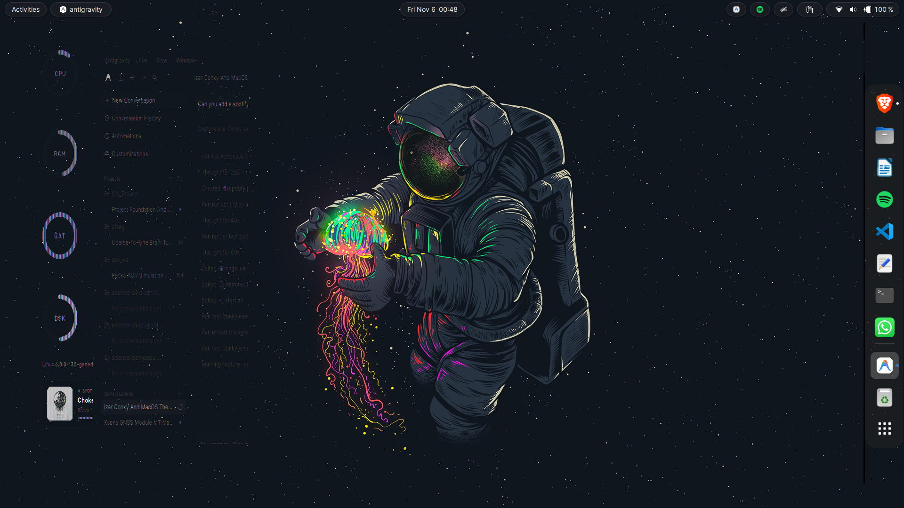
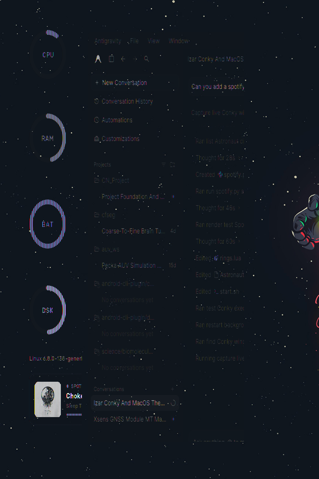
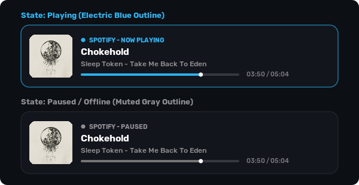

# Astronaut Desktop for Ubuntu (GNOME 42+)

A sleek, modern, dark aesthetic desktop configuration for Ubuntu featuring a custom subpixel Cairo-rendered Conky suite, a live MPRIS2 Spotify music player card, floating pill top bar, and right-side dock integration.



---

## Features

* **Subpixel Cairo Conky Suite**:
  * **Digital Clock and Calendar**: Retro `Dot Matrix` font with a vertical day of the week column.
  * **Circular Hardware Rings**: CPU (Orange), RAM (Pink), Battery (Cyan), and Disk (Yellow) with mathematically centered labels.
  * **Weather Telemetry**: Live temperature, weather condition, humidity, and wind speed.
  * **Network Telemetry and Live Graph**: SSID, signal quality %, local IP, upload/download speeds, and an antialiased dual-bandwidth sparkline graph in Cairo.
  * **Spotify Music Player Card**:
    * Direct MPRIS D-Bus bridge (sub-7ms query latency).
    * Automated album art fetcher and rounded corner thumbnail caching.
    * Dynamic state-based outline: **Vibrant Blue** (`#29B6F6`) when playing, **Subtle Gray** (`#666666`) when paused or offline.
    * Track title, artist, album, live progress bar, playhead glow, and elapsed/total timestamps.
    * Fallback vector soundwave logo when idle or offline.
  * **Bottom Telemetry Line**: Kernel version, CPU, RAM, Battery, and Disk percentages.

* **GNOME Shell Customizations**:
  * **Floating Island Top Bar**: Transparent panel with floating rounded pill islands (`rgba(30, 32, 40, 0.75)` with subtle borders and shadows).
  * **Floating Dock on Right**: Centered floating pill on the right side of the screen with auto-hide/intellihide.
  * **Dock Anti-Clipping Fix**: Custom CSS padding and scrollview adjustments preventing hover highlight clipping on outermost apps.
  * **Theme and Icons**: Orchis-Dark shell theme paired with `Yaru-blue-dark` icon pack.

---

## Screenshots

| Conky and Spotify Zoom | Spotify Dynamic Outline States |
| :---: | :---: |
|  |  |

---

## Quick Start (Automated Install)

### 1. Clone the repository
```bash
git clone https://github.com/pengeon1/astronaut-desktop.git
cd astronaut-desktop
```

### 2. Run the installer
```bash
# Complete setup (Conky + Fonts + Wallpaper + Theme + GNOME dock settings)
./install.sh
```

> [!NOTE]
> If you only want the Conky widget without changing your system theme or dock:
> ```bash
> ./install.sh --conky-only
> ```

---

## What the Installer Does

1. **System Dependencies**: Automatically checks and installs `conky-all`, `gnome-shell-extensions`, `dconf-cli`, `playerctl`, `python3-pil`, `curl`, and `jq`.
2. **Typography**: Installs `Dot Matrix` and `Rubik` fonts into `~/.local/share/fonts/` and refreshes `fc-cache`.
3. **Conky Suite**: Deploys configurations and Lua scripts to `~/.config/conky/Astronaut/` and registers login autostart (`~/.config/autostart/`).
4. **Desktop Wallpaper**: Copies `astronaut-jellyfish.jpg` to `~/Pictures/Wallpapers/` and activates it.
5. **Theme and Shell Styles**: Installs `Orchis-Dark` and applies custom CSS rules for floating island pills and dock padding.
6. **GNOME Preferences**: Configures dock position (`RIGHT`), auto-hide, dark preference, and window controls.

---

## Repository Structure

```text
astronaut-desktop/
├── conky/                          # Conky configuration and Lua scripts
│   ├── Astronaut.conf             # Main Conky config (geometry, transparency)
│   ├── lib/
│   │   └── rings.lua              # Complete Cairo drawing engine
│   ├── scripts/
│   │   ├── spotify.py             # MPRIS D-Bus bridge and cover cache
│   │   ├── weather.sh             # Weather scraper
│   │   └── day_vertical.sh        # Day-of-week helper
│   └── start.sh                   # Detached process launcher
├── fonts/                          # Typography (Dot Matrix and Rubik)
├── wallpaper/                      # 1080p Astronaut & Jellyfish wallpaper
├── theme/                          # Patched Orchis GNOME Shell CSS
│   └── gnome-shell/
├── autostart/                      # XDG Desktop entry for login launch
├── settings/                       # GNOME and Dash-to-Dock preferences
│   ├── dash-to-dock.dconf
│   └── apply-gnome-settings.sh
├── previews/                       # Screenshots for documentation
├── install.sh                      # Turnkey automated installer
├── uninstall.sh                    # Clean uninstaller script
└── README.md
```

---

## Requirements

* **Operating System**: Ubuntu 22.04 LTS / 24.04 LTS (or any Linux distribution running GNOME 42+).
* **Display**: Optimized for 1080p (1920x1080).
* **Music Player**: Spotify (Snap, Flatpak, or Native Debian package).

---

## Uninstallation

To remove the Conky configuration and optionally reset your dock:
```bash
./uninstall.sh
```

---

## Credits and Acknowledgments

* **Conky**: Built on [Conky](https://github.com/brndnmtthws/conky) with Cairo Xlib graphics.
* **Orchis Theme**: Based on [Orchis-theme](https://github.com/vinceliuice/Orchis-theme) by vinceliuice.
* **Icons**: `Yaru-blue-dark` by Canonical and Ubuntu Community.
* **Fonts**: `Dot Matrix` and Google Fonts `Rubik`.
